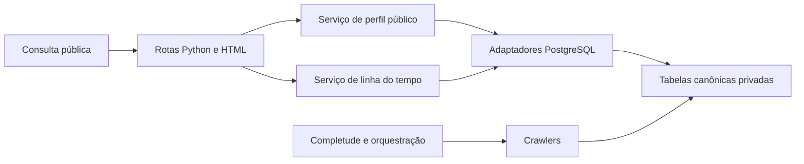

# Perfil público e linha do tempo política

Desenho inicial em 17/10/2026. Prioridade: consulta pública de pessoas. Esta especificação e a prévia visual não são uma API publicada nem um frontend conectado ao banco. Não foram criadas tabelas ou alteradas fontes originais para este desenho.

## Experiência pública

Busca por nome público, partido, UF e cargo confirmado; resultados distinguem pessoa candidata de ocupante atual. O perfil abre pela identidade interna estável e exibe:

- Foto institucional, com fonte e alternativa neutra se indisponível. Nunca substituir por foto de outra pessoa.
- Nome público e identificação do órgão/cargo atual confirmado.
- Partido atual confirmado e data da observação. Se só houver declaração eleitoral, mostrar partido daquela eleição, sem anunciá-lo como filiação atual.
- Idade em anos completos, calculada no backend a partir do nascimento confirmado e da data da consulta. A API pública pode retornar a idade sem divulgar documento ou data completa de nascimento.
- Tempo no exercício atual, em anos e meses completos, somente com início individual comprovado. Legislatura não é data de posse da pessoa. Se desconhecido, mostrar “Início do exercício não confirmado”.
- Remuneração: bruto, deduções, líquido, órgão e competência. Valor mensal publicado não é o subsídio legal previsto nem remuneração garantida no mês corrente. Distinguir “competência vigente”, “última publicada” e “desatualizada”.
- Resumo de cobertura com lacunas relevantes e data de atualização. Uma ausência de dados não é ausência de atividade, cargo, renda ou patrimônio.

Quando existirem vários vínculos atuais, mostrar todos, identificando cada órgão. Não somar pagamentos para chamar o resultado de salário de um cargo. O destaque usa um vínculo selecionado explicitamente; a pessoa pode trocar de vínculo na interface.

A linha do tempo reúne candidaturas, resultado eleitoral, mandatos, períodos individuais de exercício, observações de partido, filiações datadas, remuneração mensal, declarações de bens e autoria legislativa. Filtros por categoria e intervalo, ordem cronológica e detalhes expansíveis. “Ver evidência” abre somente fonte oficial pública revisada; os valores da interface vêm das tabelas, sem abrir o arquivo original durante a consulta.

## Regra temporal

Cada evento tem identidade estável da ocorrência, pessoa, categoria, conteúdo público, qualidade, fontes e tempo. Não transformar ano ou competência em um dia fictício.

- `date_precision`: `day`, `month`, `year`, `unknown`.
- `occurred_on`, `period_start`, `period_end_exclusive`: datas apenas quando comprovadas. Mês/ano podem usar chaves próprias sem declarar acontecimento no primeiro dia.
- `observed_at`: quando a fonte foi observada; não é a data do fato.
- `recorded_at`: quando o sistema registrou; não é a data do fato.
- `temporal_basis`: ocorrência explícita, intervalo de exercício, competência, ano eleitoral, observação institucional ou desconhecida.
- `quality`: confirmado, declarado, reportado, conflitante ou insuficiente, com escopo definido. “Confirmado” não transforma autodeclaração patrimonial em auditoria de riqueza.

Datas desconhecidas aparecem em seção própria. Eventos apenas anuais/mensais ficam agrupados nesse período; não estabelecem ordem diária entre si. Correções preservam proveniência. Filiação jurídica e partido observado são categorias distintas, com intervalos de informação SCD2 separados dos intervalos de permanência real.

Idade usa anos completos na data `as_of`, no fuso America/Belem. Nascimento ausente, conflitante ou futuro produz valor nulo e estado explícito. Em nascimento de 29/02, a convenção de aniversário adotada para apresentação deve estar testada e documentada; não é regra para idade legal.

Tempo no cargo usa o intervalo individual de exercício vigente, respeita início/fim exclusivo e não soma afastamentos. Um novo mandato não equivale automaticamente a novo exercício contínuo. Tempo acumulado é uma métrica separada: exige união dos intervalos comprovados para evitar contagem dupla; não integra o primeiro destaque.

## Backend proposto

Aplicação Python com FastAPI, serviços e adaptadores PostgreSQL existentes. HTML renderizado no servidor com templates Jinja2 e CSS; formulários GET e links permitem busca, filtros e paginação sem código JavaScript. Essa escolha respeita a convenção Python do projeto e mantém uma implantação inicial simples.

- `application/web/`: rotas HTTP, validação de filtros e respostas JSON/HTML.
- `service/public_profile/`: composição do perfil público, idade, tempo no exercício e atualidade da remuneração.
- `service/timeline/`: composição de eventos, precisão temporal, qualidade e paginação.
- `database/public_profiles.py` e `database/timeline.py`: consultas parametrizadas, em lotes, sem acesso HTTP às fontes.
- `presentation/templates/` e `presentation/static/`: páginas HTML, CSS e imagens públicas autorizadas.

Os diretórios acima são proposta de implementação, não módulos já disponíveis.

A consulta pública é somente leitura e nunca dispara crawlers. Workers continuam separados e atualizam fatos antes da leitura. Pendências podem ser resumidas como cobertura; não são eventos históricos da pessoa.

## Fontes relacionais da linha do tempo

- Perfil: `person`; foto e campos atuais são retratos, com evidência específica quando disponível.
- Partido: `political_party_affiliation` + `political_party`, considerando escopo e período de informação. Relatos em `person_fact` exigem normalização e interpretação explícita antes de virar filiação jurídica.
- Candidatura/resultado: `electoral_candidacy`. Ano de eleição não comprova dia da candidatura, posse ou exercício.
- Mandato/exercício: `office_term` + `office_exercise` + `institution`. O retrato da pessoa pode confirmar exercício sem conhecer o início individual; nesse caso a duração continua nula.
- Pagamento: `person_payroll_payment`, com identidade verificada e competência. Os valores são colunas materiais; detalhes adicionais podem vir do payload já armazenado em tabela, nunca de leitura de arquivo na requisição.
- Bens: `candidate_asset_declaration`, agrupados por pessoa/eleição, com soma decimal e preservação de valores negativos sinalizados. Não somar patrimônios de anos distintos nem anunciar valor atual comprovado.
- Autoria: `proposition_person` + `proposition`. Não inferir aprovação, lei sancionada ou impacto. Número e ano podem ser nulos. Sem data de apresentação comprovada, o evento vai para grupo sem data.
- Votos, leis, emendas e benefícios: habilitar na UI apenas quando existirem fatos ingeridos e vinculados, mesmo que já haja tabelas no esquema.

## Cobertura da trajetória pública

A presença de uma autoria não comprova cobertura da vida pública. O diagnóstico deve considerar pessoa, instituição, categoria e intervalo: início conhecido da trajetória, períodos pesquisados, atualização mais recente e períodos ainda não pesquisados. O início conhecido é a evidência mais antiga disponível, sem afirmar que seja o início real da atuação pública.

Separar proposta apresentada, autoria/coautoria, relatoria, tramitação, resultado coletivo, voto individual e norma publicada. Rejeição, arquivamento, retirada e veto são resultados diferentes. Empresas exigem vínculo societário ou administrativo comprovado e período; participação declarada como bem não prova sociedade atual. Parcerias precisam de instrumento ou participação documentada, com papel, contraparte e datas; uma coautoria não comprova parceria empresarial.

O serviço de avaliação de cobertura deve encaminhar lacunas para a completude/orquestração existente. A pesquisa histórica é particionada por fonte e período; a atualização incremental reutiliza recursos baixados, cache e limites por fonte. Não criar uma fila concorrente nem buscar pessoa a pessoa quando a fonte oferecer lotes. A implementação e o inventário de coletores dependem da auditoria de cobertura; não estão disponíveis nesta prévia.

Começar com consultas/projeções de leitura sobre essas tabelas. Não criar outra tabela com cópia integral de todos os fatos só para desenhar a linha do tempo: economiza espaço e evita divergência. Uma futura projeção materializada exige medição e estratégia de atualização explícita.

## Contratos HTTP propostos

### Atuação no cargo

A segunda visão do perfil é “Atuação no cargo”, demonstrada em `prototipo-linha-do-tempo/atuacao.html`. O filtro seleciona um exercício identificado por chave interna e instituição, além do período dos acontecimentos. Trocar de cargo troca suas atribuições e a atividade vinculada àquele exercício; a identidade, idade e cargo atual do cabeçalho continuam sendo informações do perfil geral.

Apresentar atribuições oficiais contextualizadas e trabalho documentado. As competências do Legislativo como órgão não são uma obrigação individual de aprovar determinada quantidade de leis. O catálogo de atribuições precisa de cargo, jurisdição/instituição, intervalo de vigência, referência oficial e resumo editorial revisado. Não reutilizar atribuições de vereador para deputado ou de parlamentar para chefe do Executivo. Catálogo inicial pode ser configuração versionada; uma tabela própria só se justifica quando seu ciclo de atualização exigir persistência administrativa.

Cada atividade tem papel da pessoa, assunto, documentos, relação com a atribuição, datas e resultado quando comprovado. Se o resultado pertence a uma comissão ou plenário, identificá-lo como coletivo. Uma mesma iniciativa possui etapas relacionadas; não contar três tramitações como três projetos. Declaração de bens e participação empresarial ficam na trajetória/contexto patrimonial, sem classificação automática de “feito do cargo”.

Os cartões de votação mostram objeto votado (texto principal, emenda, parecer ou outro), data/precisão, órgão, etapa/turno, participação individual, escolha e resultado coletivo. “Participou” exige evidência individual; presença na sessão não prova participação em todas as votações. Exibir `Sim · a favor`, `Não · contra [objeto]`, abstenção ou obstrução conforme publicado. Distinguir ausência explicitamente registrada, presidência, presença sem voto, justificativa publicada e informação indisponível. Não converter esses estados em voto contrário. Votação simbólica ou secreta sem lista nominal mantém voto individual indisponível. Lei resultante é um vínculo oficial separado; o cartão pode ter links para votação, texto e norma quando existirem.

Na prévia, esses cartões integram a mesma linha do tempo das atividades, agrupados pelo mês/ano do acontecimento. Uma lei relacionada aparece no mês da votação de cada objeto/turno, com a data completa no cartão quando conhecida. Publicação da norma é evento separado na sua própria data; nunca reposicionar o voto pela data da publicação. A mesma iniciativa não é contada como várias leis por ter múltiplas etapas. Se o mês da votação não estiver comprovado, manter em grupo sem data suficiente, sem usar data de ingestão.

A linha do tempo mostra progressão, rejeição, arquivamento, retirada, veto e resultados desconhecidos de forma distinta. Evolução da atividade por ano exige denominadores e cobertura comparáveis: período efetivo no exercício, afastamentos, fontes consultadas e domínios cobertos. Uma diferença de quantidade é uma diferença de registros disponíveis, não prova de melhora ou piora. Não criar nota de desempenho baseada apenas em volume ou taxa bruta de aprovação.

Filtros: exercício/cargo, intervalo, atribuição, tipo de atividade, papel e resultado. Ordenação por acontecimento comprovado; não usar data de coleta para sugerir atividade recente. Quando uma iniciativa iniciada antes do filtro tiver andamento no período, mostrar esse andamento e sua relação com a iniciativa, sem imputar nova autoria naquele ano. Atividades com atribuição ou exercício ainda não comprovados permanecem separadas como “vínculo a confirmar”.

No backend proposto, `service/office_activity/` relaciona fatos canônicos a exercícios e ao catálogo; não consulta fontes remotas nem avalia mérito político. O adaptador faz consultas em lotes por chave de exercício e período, com paginação. `GET /api/v1/people/{person_id}/office-activity?exercise_id=&from=&to=&responsibility=&type=&role=&outcome=&cursor=&limit=` retorna atribuições referenciadas, fatos e cobertura do mesmo recorte. Campos e classes só serão criados ao implementar o backend; esta seção é contrato de desenho.

Referências iniciais: [trabalho do deputado estadual na ALESP](https://www.al.sp.gov.br/deputados/trabalho-deputado/), [atribuições do Legislativo paulista](https://www.al.sp.gov.br/deputados/trabalho-deputado/atribuicoes/), [função do vereador paulistano](https://www.saopaulo.sp.leg.br/camaraexplica/tudo-sobre-os-vereadores/funcao-do-vereador/) e [papel do deputado federal](https://www.camara.leg.br/noticias/545049-saiba-o-que-faz-um-deputado-federal).

### Perfil e trajetória

- `GET /api/v1/people?q=&political_party=&uf=&office_kind=&cursor=&limit=`: busca paginada, sem exigir ou divulgar documentos.
- `GET /api/v1/people/{person_id}`: perfil público, vínculos atuais, foto, idade, tempo e remuneração referenciada.
- `GET /api/v1/people/{person_id}/timeline?categories=&from=&to=&cursor=&limit=`: eventos paginados; categoria, precisão e origem temporal sempre presentes.
- `GET /api/v1/people/{person_id}/payments?organization=&from=&to=&cursor=&limit=`: pagamentos materiais por competência/órgão.
- `GET /pessoas` e `GET /pessoas/{slug}`: frontend HTML servido pelos mesmos serviços, sem fazer chamadas HTTP a si próprio.

Padrão de 30 itens, máximo de 100. Cursor opaco contém ordenação, versão, filtros e desempate; filtros incompatíveis invalidam cursor. Ordem determinística por período de agrupamento, precisão, categoria e identidade do evento; a chave de ordenação não é apresentada como uma data real. Grupo sem data tem paginação própria.

Resposta de perfil usa `as_of` e estados separados para cada campo. Foto contém URL pública validada, atribuição e estado; partido contém nome/sigla, escopo e data de confirmação; idade contém valor/estado; tempo contém anos/meses/início e estado; remuneração contém órgão, cargo, moeda, competência, bruto/deduções/líquido e atualidade. Valores monetários são strings decimais no JSON, sem `float`.

Erro de pessoa inexistente retorna 404. Ausência de salário ou foto em pessoa existente retorna campo nulo com estado; não retorna 404 para todo o perfil nem valor zero. Erros de entrada usam códigos estáveis, sem SQL ou caminhos internos.

## Segurança e eficiência

API pública usa uma projeção explícita de campos. CPF, RG, fingerprints, chaves externas pessoais, nomes históricos usados só para resolução, credenciais, caminhos de armazenamento e revisões privadas não são serializados. Atributos de identificação internos não ficam em HTML oculto. O banco permanece privado; o navegador não recebe conexão PostgreSQL nem credencial administrativa.

A conexão do backend deve ter privilégio mínimo de leitura nas projeções necessárias. Acesso de operação/escrita usa credencial separada. Fotos usam destinos oficiais validados ou cache de mídia com limite/validação; fallback neutro evita inventar rosto. Textos de fontes são escapados nos templates e links não executam conteúdo da fonte.

Buscar por `person_id` e paginar em SQL; evitar carregar toda a biografia para cada página. Usar índices existentes por pessoa/competência e pessoa/eleição; medir índices de afiliação, autoria e busca textual antes de criar novos. Uma página de k eventos exige ao menos O(k); índices de árvore não são O(1). Cache curto de leitura pode usar versão dos fatos e filtros; não dispara coleta e não esconde o horário de referência.

## Critérios do primeiro incremento

Perfil público acessível por teclado e celular; foto/fallback; partido/estado temporal; idade confirmada ou desconhecida; duração somente com início individual; remuneração e competência claramente separadas. Busca e filtros funcionais, paginação estável, eventos sem data visíveis, dados não disponíveis sem zeros fictícios. Testar aniversário, transição de exercício, períodos sobrepostos, remuneração atrasada, filiação apenas observada, documento sem número e ausência de fatos.

Prévia em `docs/prototipo-linha-do-tempo/index.html`: ilustração e dados fictícios, sem conexão ao banco. Filtros por categoria e detalhes funcionam com HTML/CSS; busca e navegação da API ainda são desenho. Não inserir dados fictícios no banco de produção.

Referências técnicas: [templates FastAPI](https://fastapi.tiangolo.com/advanced/templates/), [templates Starlette](https://starlette.dev/templates/).

## Primeira rota operacional de votos

A API local Python é iniciada com `se-liga-brasil serve-public-api --env-file CAMINHO_ENV --port 8779`. O transporte de desenvolvimento escuta apenas em loopback; não é um servidor de implantação pública.

`GET /api/people/{person_id}/votes?start_date=YYYY-MM-DD&end_date=YYYY-MM-DD&limit=30` consulta exclusivamente tabelas canônicas. O período é obrigatório e inclusivo. Filtros opcionais: `office_kind`, `exercise_id`, `cursor`. A página tem no máximo 100 votos. `next_cursor` permite avançar mantendo o mesmo recorte.

A resposta separa proposição, objeto da votação, data e precisão, mês, órgão, turno, participação individual, escolha do voto e resultado coletivo. O vínculo com exercício usa instituição e intervalo comprovado, sem inferir exercício apenas pela candidatura. Ausência de votos vinculados não significa inatividade. A cobertura descreve somente intervalos e canais documentados; não certifica toda a trajetória.

Cada consulta usa uma transação consistente somente de leitura e timeout de cinco segundos para SQL. A rota não executa crawlers, não abre arquivos originais e não expõe CPF, nascimento, documentos ou hashes privados de identidade. Erros internos retornam uma mensagem genérica. A API pode devolver nome público e UUID interno. Consultas sem período ou com parâmetros inválidos retornam 400; pessoa inexistente retorna 404.

Esta fatia ainda não conecta a prévia HTML à API e não entrega o cabeçalho completo do perfil com foto, partido vigente, idade, cargo e remuneração. Essas funções permanecem critérios do entregável público em andamento.
